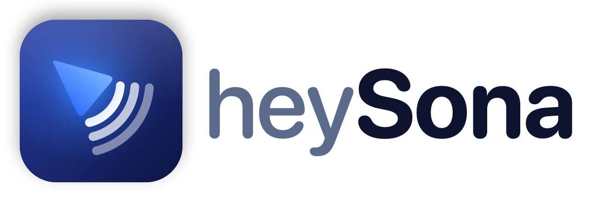

<p align="center">
  <picture>
    <source media="(prefers-color-scheme: dark)" srcset="branding/heysona-logo-dark.png">
    
  </picture>
</p>

heySona is an AI companion that lives in your Mac's menu bar. Hold a shortcut and talk (or type), and it looks at your screen, answers out loud, and can point at things, open apps, set reminders, read your project's code, and remember what matters to you.

It's a personal app: it runs entirely on your Mac and talks to Claude, ElevenLabs, and AssemblyAI directly with your own API keys.

## Features

- **Talk or type.** Hold **Control + Option** to talk, or double-tap **Control** to type a question in a Spotlight-style box.
- **Sees your screen.** Each question includes a screenshot of every connected display, taken only when you ask.
- **Answers out loud.** Replies are spoken with an ElevenLabs voice you pick, or a free built-in Mac voice. Turn speech off and replies appear as a text bubble next to your cursor.
- **Points at things.** A small blue cursor flies to the button, menu, or text it's talking about, on any monitor.
- **Stop anytime.** Press **Esc** while heySona is thinking or speaking to cut it off.
- **Does things on your Mac.** Open apps, links, and files; find files; play, pause, and skip tracks; change the volume; add reminders and calendar events; run your Shortcuts (you approve each one).
- **Remembers you.** Tell it about your projects, tools, and preferences, and it remembers them across sessions. Every memory is listed in Settings, where you can delete it.
- **Knows your project.** Detects the git project of the file open in your front window (Xcode, editors, Terminal), or a folder you pin, and can read its files to help with code. Read-only.
- **Saves notes.** Say "save that to my notes" to keep an answer in Apple Notes, an Obsidian vault, or a Markdown folder.
- **Your choice of model.** Claude Opus 5.5 (default, smartest), Sonnet 5.5 (balanced), or Haiku 5.5 (fastest).

## Requirements

- macOS 14.2 or later
- A recent version of Xcode (with its license accepted: open Xcode once and click **Agree**)
- API keys:
  - [Anthropic](https://console.anthropic.com/settings/keys) (required)
  - [ElevenLabs](https://elevenlabs.io/app/settings/api-keys) (optional: the most natural voice; without it, or when it runs out of credits, heySona uses the free built-in Mac voice)
  - [AssemblyAI](https://www.assemblyai.com/dashboard) (optional; or pick WhisperKit in Settings to transcribe on your Mac for free; with neither, heySona uses Apple's built-in speech recognition)

## Setup

1. Clone the repo and open the project:

   ```bash
   git clone git@github.com:codekalimi/heySona.git
   cd heySona
   open leanring-buddy.xcodeproj
   ```

2. In Xcode, select the `leanring-buddy` scheme, choose your team under **Signing & Capabilities**, and press **⌘R**. (The "leanring" spelling is a leftover from the original project and is kept on purpose.)

   Build and run from Xcode only. Building with `xcodebuild` from the terminal resets the app's macOS permissions.

3. heySona appears in the menu bar (there's no Dock icon). On first launch it asks for each API key and saves it in your macOS Keychain. You can change keys later in **Settings**.

4. Grant the permissions the panel asks for:

   | Permission | Why |
   |---|---|
   | Microphone | Hearing you while you hold the shortcut |
   | Accessibility | The global shortcuts, media keys, and detecting your active project |
   | Screen Recording | Screenshots when you ask a question |
   | Screen Content | ScreenCaptureKit access |

   A few more are requested only the first time you use the feature that needs them: Speech Recognition (if you don't use AssemblyAI), Reminders, Calendars (add-only access), and Automation for Apple Notes.

## Using heySona

| Do this | To |
|---|---|
| Hold **Control + Option**, speak, release | Ask about your screen |
| Double-tap **Control**, type, **Enter** | Ask by typing |
| **Esc** | Stop the current reply |
| Click the menu bar icon | Open the panel (model picker, "Type a question", Settings) |
| Click the gear in the panel | Open Settings |

Things to try:

- "What does this error mean?"
- "Where's the export button?" (watch the cursor)
- "Open Safari" · "Set the volume to 30" · "Skip this song"
- "Remind me to call mom tomorrow at 6" · "Add lunch with Sam on Friday at 1"
- "Remember that I use Neovim" · "Forget that"
- "What branch am I on?" · "Explain what this file does"
- "Save that to my notes"

### Settings

- **API keys:** save, replace, or remove each key (only the last 4 characters are ever shown).
- **Conversation history:** heySona remembers past conversations across restarts, writes a short journal entry for each session so it knows what you've been learning, and can search older chats when you mention them. Stored only on your Mac (never screenshots); clear it anytime in Settings.
- **Voice:** speak replies aloud or show them as text, choose ElevenLabs or the free Mac voice, pick a voice, and preview it.
- **Mac actions:** turn all actions on or off.
- **Memory:** turn memory on or off, review every remembered fact, delete one or all.
- **Project:** turn project awareness on or off, and pin a fallback folder.
- **Notes:** choose Apple Notes, an Obsidian vault, or a Markdown folder (default `~/Documents/heySona Notes`).
- **Claude model:** Haiku, Sonnet, or Opus.

## Privacy and safety

- **Your keys stay in your Keychain** (service name `heySona`) and are sent only to the service they belong to.
- **Screenshots are taken only when you ask** a question, and heySona's own windows are left out of them.
- **Memory is stored only on your Mac**, in `~/Library/Application Support/heySona/long-term-memory.json`.
- **Claude is told never to follow instructions it reads on your screen**, in web pages, or in file names, and never to save them to memory.
- **Guardrails on actions:** Shortcuts always need your approval; apps, scripts, and installers are only revealed in Finder, never opened; project files are read-only and nothing outside the project folder can be read; only web links (http/https) are opened.
- **No analytics or tracking.** heySona sends nothing anywhere except your requests to Anthropic, ElevenLabs, and (if you use it) AssemblyAI.

## How it works

heySona is a SwiftUI app with AppKit where it needs it: a menu bar item, a floating control panel, a full-screen transparent overlay for the cursor, and a regular window for Settings.

1. **Listen.** Push-to-talk audio streams to AssemblyAI over a websocket, or is transcribed on your Mac by WhisperKit (or Apple Speech), and becomes a transcript when you release the keys.
2. **Look.** ScreenCaptureKit captures every display, labeled so Claude knows which screen the cursor is on.
3. **Think.** The transcript, screenshots, recent conversation, remembered facts, the local time, and any active project are sent to Claude with streaming. Claude can call tools (Mac actions, memory, project files, notes) in a loop before it answers.
4. **Answer.** The reply is spoken through ElevenLabs (or shown as text). If it contains a `[POINT:x,y:label:screenN]` tag, the cursor flies to that spot.

For the full technical details, see [`AGENTS.md`](AGENTS.md) (also available as `CLAUDE.md`).

## Project structure

```
leanring-buddy/                     Swift source
  leanring_buddyApp.swift             App entry point (menu bar only)
  CompanionManager.swift              Central state: listen → screenshot → Claude → speak → point
  ClaudeAPI.swift                     Claude streaming client and tool-use loop
  ClaudeModelCatalog.swift            Models offered and per-request settings
  MacActionTools.swift                Mac action tool definitions
  MacActionExecutor.swift             Runs Mac actions
  PersonalContextTools.swift          Memory, project, and notes tools
  LongTermMemoryStore.swift           Remembered facts
  ActiveProjectContext.swift          Project detection and read-only file access
  NoteSaver.swift                     Apple Notes, Obsidian, and Markdown notes
  TypeToAskPanelManager.swift         Double-tap Control text box
  GlobalHotKeyRegistrar.swift         System-wide shortcuts
  SettingsView.swift                  Settings window
  APIKeyKeychainStore.swift           API keys in the Keychain
  ElevenLabsTTSClient.swift           Spoken replies
  AssemblyAIStreamingTranscriptionProvider.swift   Live speech-to-text
  OverlayWindow.swift                 The blue cursor overlay
leanring-buddy.xcodeproj/           Xcode project
AGENTS.md                           Architecture notes for coding agents (CLAUDE.md links here)
branding/                           Logo (light and dark) and the scalable SVG mark
scripts/generate-brand-assets.swift Draws the app icon, logo, and SVG from one design
```

To change the icon or logo, edit `scripts/generate-brand-assets.swift` and run it from the repository root:

```bash
swift scripts/generate-brand-assets.swift
```

## Credits and license

heySona is built on the open-source [Clicky](https://github.com/farzaa/clicky) project by Farza, released under the MIT License. See [`LICENSE`](LICENSE).

On-device speech-to-text uses [WhisperKit](https://github.com/argmaxinc/argmax-oss-swift) (MIT) with Whisper models downloaded from Hugging Face on first use.

The visual explainer bundles [three.js](https://github.com/mrdoob/three.js) r160 and [KaTeX](https://github.com/KaTeX/KaTeX) 0.18.11, both MIT-licensed (license files are next to them in `leanring-buddy/VisualExplainer.bundle/`).
